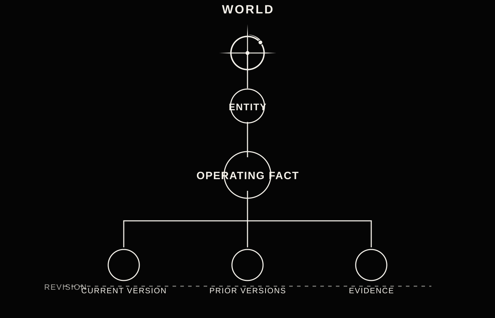

# WORLDLINE

**A revisioned world model for a computer you can operate against.**

WORLDLINE turns a changing desktop into explicit, evidence-bearing state.

Not a screenshot loop. Not an accessibility dump. Not a bag of tool calls.

The core unit is an **Operating Fact**: a versioned statement about the machine that is current and trustworthy enough to operate against.

> **An Operating Fact is a versioned, evidence-bearing statement about the machine that WORLDLINE can presently operate against.**

```text
WORLD
  └── ENTITY
       └── OPERATING FACT
            ├── current version
            ├── prior versions
            └── evidence
```

A WORLDLINE **Revision** is the temporal cross-section of the Operating Fact versions that constitute the world at that point.



## Why

Desktop automation often discards information the operating system already knows and then asks pixels to reconstruct it.

WORLDLINE takes the opposite position:

```text
direct OS truth
      ↓
correlation
      ↓
derivation
      ↓
optional perception / inference
      ↓
agent reasoning
```

Use direct truth when the machine already has it. Use pixels when pixels are the truth. Use inference when neither is enough.

## Truth has a type

```text
DIRECT  >  CORRELATED  >  DERIVED  >  INFERRED
```

- **Direct** — the underlying subsystem stated it.
- **Correlated** — independently observed identities were joined by evidence.
- **Derived** — WORLDLINE calculated it from known facts.
- **Inferred** — a model or heuristic interpreted ambiguous evidence.

Unknown is valid. Stale is valid. Invalid is valid.

A plausible lie is not.

## The model

```text
SOURCE
  ↓
OBSERVATION
  ↓
EVIDENCE
  ↓
OPERATING FACT
  ↓
WORLDLINE REVISION
  ↓
ACTION / REASONING
```

```text
entity
  window:482

operating fact
  window:482.focused

version
  window:482.focused@32 = true

evidence
  Mutter focus-window
  observed at R18492
```

A repeated observation of the same value confirms the current version. It does not create a new version merely because WORLDLINE looked again.

## Architecture

WORLDLINE is designed as a continuously maintained fact graph rather than a giant polling function.

```text
collectors
    │
    ▼
┌──────────────┐
│  FACT STORE  │
│ living world │
└──────┬───────┘
       │
       ▼
┌──────────────┐
│ ENTITY GRAPH │
│ app ─ window │
│  │      │    │
│ proc  a11y   │
│         │    │
│       pixels │
└──────┬───────┘
       │
       ▼
   seal revision
       │
       ▼
   WORLDLINE Rₙ
```

`capture()` should seal what WORLDLINE currently knows. It should not rediscover the desktop from scratch.

## Platform target

The first serious platform target is **Ubuntu GNOME Wayland**, with GNOME 50/51 treated as versioned platform adapters rather than assumptions baked into the truth core.

The production collector model composes the desktop interfaces already present on that system:

- **GNOME Shell / Mutter** — windows, focus, stacking, workspaces, displays.
- **AT-SPI2** — semantic UI and accessibility events.
- **PipeWire** — media graph and frame transport.
- **XDG Desktop Portal** — authorized capture/input sessions.
- **systemd-logind** — login/session state.
- **NetworkManager** — network state.
- **UPower** — power state.
- **GSettings** — desktop configuration.
- **`/proc`** — process facts.
- **inotify** — scoped filesystem changes.

The GNOME integration belongs behind a small version-specific adapter. The truth core should not become a pile of compositor assumptions.

## Failure is data

WORLDLINE must never silently convert degraded observation into apparently normal state.

```text
AT-SPI unavailable
→ semantic capability unavailable

Mutter generation changed
→ compositor-backed identities invalidated

event queue overflow
→ source.gap
→ reconciliation required

PipeWire stream replaced
→ old stream generation invalidated
```

Recovery may be automatic. Loss may not be invisible.

## Identity

```text
session:<boot-id>:<logind-session-id>
process:<boot-id>:<pid>:<proc-starttime>
window:<session-generation>:<compositor-generation>:<stable-sequence>
```

PID alone is not identity. A dead compositor generation cannot silently resurrect old windows.

## Action verification

```text
observe → act → correlate → verify
```

not:

```text
act → sleep → hope
```

Transactions bind an action to a before-revision, explicit preconditions, resulting revisions, postconditions, and evidence.

## Performance bar

Initial targets — **targets, not claims until benchmarked**:

| Metric | Target |
| --- | ---: |
| Idle CPU | < 0.25% of one core |
| Idle daemon RSS | < 50 MiB |
| Ordinary event → fact | p99 < 2 ms |
| Ordinary event → sealed revision | p99 < 5 ms |
| Warm full snapshot | < 10 ms |
| Daemon restart recovery | < 250 ms |
| Steady-state polling where native events exist | 0 Hz |
| Root required | never |
| Network required | never |
| Silent fact loss | never |

## Current repository

```text
src/worldline/
  model.py          typed world facts and evidence
  store.py          optimistic revisioned state store
  capabilities.py   evidence-backed readiness ladder
  transactions.py   pre/postcondition transaction primitives
  protocol.py       versioned RPC envelope
  daemon.py         Unix-socket daemon
  providers/        observation/capability providers
    gnome.py        read-only GNOME/Wayland host facts
  consumers/        consumer adapters
```

The runtime now has a read-only GNOME provider, real freshness fences, and contingent predicate waits. Cua/GWCU remains the actuation layer; `.gwcu` remains durable machine/workspace truth. The next work is deeper event coverage and typed compositor/media generations without bloating the core.

## Quick start

```bash
python -m venv .venv
. .venv/bin/activate
pip install -e '.[dev]'
pytest
worldline --socket /tmp/worldline.sock
```

From another shell:

```bash
worldlinectl --socket /tmp/worldline.sock status
worldlinectl --socket /tmp/worldline.sock query
worldlinectl --socket /tmp/worldline.sock observe
worldlinectl --socket /tmp/worldline.sock fence
```

## Invariants

1. **No identity without generation.**
2. **No silent loss.**
3. **No hidden inference.**
4. **No fake atomicity.**
5. **No PID identity.**
6. **No action without a before-state.**
7. **No success without evidence.**
8. **No giant rescan where a native event exists.**
9. **No consumer-specific meaning in base truth.**
10. **No regression disguised as architectural improvement.**

## Cua boundary\n\nWORLDLINE does not drive the desktop. Cua Driver remains the sole GUI actuator; GWCU composes policy and action spans around it. WORLDLINE supplies revisioned evidence, invalidation, fences, waits, and receipts. See [`docs/CUA_INTEGRATION.md`](docs/CUA_INTEGRATION.md).\n\n## Identity and media

The canonical mark and vector media family live in [`assets/brand/`](assets/brand/README.md).

The symbol encodes the same idea as the system: **a world, a present coordinate, an observation, and a trajectory through change.**
