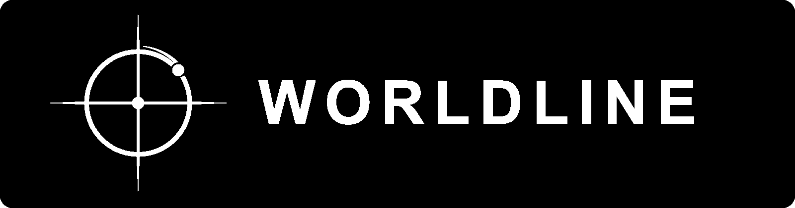

<p align="center">
  
</p>

# WORLDLINE

> **WORLDLINE is the current.**

A live, revisioned view of what the machine knows now.

## Operating Fact

An **Operating Fact** is a typed statement about the machine at a particular revision.

```text
Operating Fact
├── type
├── value
├── revision
└── evidence
    ├── source
    ├── observed_at
    └── detail
```

The value is the present coordinate.

The type tells the system what kind of coordinate it is.

The evidence receipt tells an agent where the coordinate came from.

That makes a fact useful as machinery.

See [`docs/OPERATING_FACT.md`](docs/OPERATING_FACT.md).

## Truth has a type

WORLDLINE keeps the kind of knowledge alongside the knowledge itself.

```text
DIRECT
  ↓
CORRELATED
  ↓
DERIVED
  ↓
INFERRED
```

A direct operating-system fact carries the authority of the subsystem that stated it.

A correlated fact carries the evidence that joined its sources.

A derived fact carries the calculation that produced it.

An inferred fact carries the observation and interpretation that produced it.

The type travels with the fact.

## Evidence receipts

Every useful fact has somewhere it came from.

Examples include:

```text
AT-SPI event
Mutter state
D-Bus property
PipeWire metadata
journal entry
state/config file
environment
Cua observation
bounded command
```

A receipt gives an agent a path back to the system that can explain or refresh the fact.

WORLDLINE carries that provenance forward with the present.

## The current

WORLDLINE joins the machine's existing sources of knowledge into one revisioned present.

```text
GNOME / Mutter
AT-SPI
PipeWire
D-Bus
system services
state files
logs
runtime interfaces
       │
       ▼
   observation
       │
       ▼
Operating Fact
       │
       ▼
   WORLDLINE
       │
       ├── revision
       ├── evidence
       ├── change
       └── query / wait
```

Observation follows the fact to the place where it naturally exists.

A native event can advance a fact immediately.

A state file or journal entry can provide the evidence.

A runtime interface can expose the current value directly.

A bounded reconciliation can refresh a source when needed.

The daemon joins these observations into the current.

## Desktop observations

WORLDLINE can ingest source-reported native facts and explicit links from
existing desktop observation infrastructure. In GNOME/Wayland setups, the
maintained computer-use driver and native GNOME / AT-SPI interfaces are the
places to seek window, focus, actor and accessibility evidence.

No additional GNOME Shell extension or alternate desktop control plane is
installed by WORLDLINE. Without an available source, WORLDLINE reports
unknown or unavailable rather than manufacturing a window inventory.

Applications and agents decide their own identity and what correspondences
mean; WORLDLINE records facts, native links, timestamps, and provenance only.

See [Desktop observation boundaries](docs/DESKTOP_OBSERVATION.md).

## Current platform

**GNOME on Wayland.**

The platform is expressed through its own operating machinery:

- **GNOME Shell / Mutter** — windows, focus, stacking, workspaces, displays.
- **AT-SPI2** — semantic UI and accessibility state.
- **PipeWire** — media graph and frame transport.
- **XDG Desktop Portal** — authorized desktop sessions.
- **systemd-logind** — login and session state.
- **NetworkManager** — network state.
- **UPower** — power state.
- **GSettings** — desktop configuration.
- **`/proc`** — process facts.
- **filesystem and journal sources** — durable machine state.

GNOME and Mutter versions are observed as part of the current. Their changing APIs become new evidence sources while the Operating Fact model remains stable.

See [`docs/OBSERVATION_SOURCES.md`](docs/OBSERVATION_SOURCES.md) and [`docs/GNOME_WAYLAND.md`](docs/GNOME_WAYLAND.md).

## Change

A WORLDLINE revision is the present coordinate of the fact world.

```text
observe
   ↓
revision
   ↓
change
   ↓
new evidence
   ↓
new revision
```

A fence establishes a causal boundary.

A contingent wait can ask for evidence that arrived after that boundary.

This gives an action a present to begin from and a current to continue into.

## Architecture

```text
sources
   │
   ▼
observation
   │
   ▼
typed facts + evidence
   │
   ▼
revisioned current
   │
   ├── query
   ├── wait
   ├── continuation
   └── capture
```

`worldlined` is the persistent observation engine.

Its work is to keep the current current.

## Repository

```text
src/worldline/
  model.py          typed facts and evidence
  store.py          revisioned state store
  capabilities.py   evidence-backed readiness
  transactions.py   pre/postcondition primitives
  protocol.py       versioned RPC envelope
  daemon.py         observation daemon
  providers/        observation providers
    gnome.py        GNOME / Wayland host facts
  consumers/        consumer adapters
```

## Quick start

```bash
python -m venv .venv
. .venv/bin/activate
pip install -e '.[dev]'
pytest
worldline --socket /tmp/worldline.sock
```

From another shell:

```bash
worldlinectl --socket /tmp/worldline.sock status
worldlinectl --socket /tmp/worldline.sock observe
worldlinectl --socket /tmp/worldline.sock query
worldlinectl --socket /tmp/worldline.sock fence
```

## Identity and media

The canonical mark and vector media family live in [`assets/brand/`](assets/brand/README.md).

The symbol carries the same idea as the system:

**a world, a present coordinate, an observation, and a trajectory through change.**
