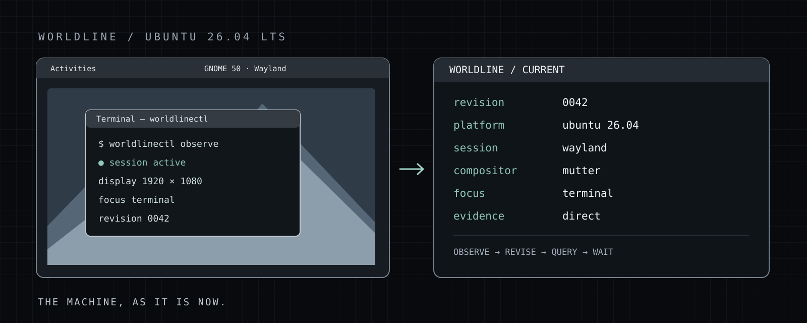

<p align="center">
  
</p>

# WORLDLINE

> **WORLDLINE is the current.**

A live, revisioned view of what the machine knows now.

## Operating Fact

An **Operating Fact** is a typed statement about the machine at a particular revision.

```text
Operating Fact
├── type
├── value
├── revision
└── evidence
    ├── source
    ├── observed_at
    └── detail
```

The value is the present coordinate.

The type tells the system what kind of coordinate it is.

The evidence receipt tells an agent where the coordinate came from.

That makes a fact useful as machinery.

See [`docs/OPERATING_FACT.md`](docs/OPERATING_FACT.md).

## Truth has a type

WORLDLINE keeps the kind of knowledge alongside the knowledge itself.

```text
DIRECT
  ↓
CORRELATED
  ↓
DERIVED
  ↓
INFERRED
```

A direct operating-system fact carries the authority of the subsystem that stated it.

A correlated fact carries the evidence that joined its sources.

A derived fact carries the calculation that produced it.

An inferred fact carries the observation and interpretation that produced it.

The type travels with the fact.

## Evidence receipts

Every useful fact has somewhere it came from.

Examples include:

```text
AT-SPI event
Mutter state
D-Bus property
PipeWire metadata
journal entry
state/config file
environment
Cua observation
bounded command
```

A receipt gives an agent a path back to the system that can explain or refresh the fact.

WORLDLINE carries that provenance forward with the present.

## The current

WORLDLINE joins the machine's existing sources of knowledge into one revisioned present.

```text
GNOME / Mutter
AT-SPI
PipeWire
D-Bus
system services
state files
logs
runtime interfaces
       │
       ▼
   observation
       │
       ▼
Operating Fact
       │
       ▼
   WORLDLINE
       │
       ├── revision
       ├── evidence
       ├── change
       └── query / wait
```

Observation follows the fact to the place where it naturally exists.

A native event can advance a fact immediately.

A state file or journal entry can provide the evidence.

A runtime interface can expose the current value directly.

A bounded reconciliation can refresh a source when needed.

The daemon joins these observations into the current.

## Observe now

The `worldline` command is a one-shot observation client. It collects only the
sections a query needs, returns compact JSON, and exits.

```bash
worldline                          # the whole current world
worldline os.kernel                # one fact
worldline windows.active           # the active window
worldline windows.active.geometry  # its frame, screen, monitor and exposure
worldline storage.0.percent        # list index
worldline storage[0].percent       # equivalent bracket form
worldline storage.*.percent        # wildcard
worldline host os storage.0        # several facts in one object
worldline --list                   # every section
worldline --pretty windows         # indented JSON
worldline --all processes          # include full process list
```

`stdout` is JSON. Errors are JSON on `stderr`: exit `1` means the path does not
exist, exit `2` means the request itself is invalid.

### What it knows

| Section | Operating facts |
| --- | --- |
| **`time`** | epoch · ISO · timezone · UTC offset |
| **`host`** | hostname · machine/boot id · uptime · hardware · GPUs · virtualization · container |
| **`os`** | distro · version · kernel · arch · libc · Python · locale |
| **`cpu`** | model · sockets · physical/logical cores · frequency · load · run queue |
| **`pressure`** | kernel PSI for CPU · memory · I/O |
| **`memory`** | RAM · swap · usage · cache · dirty pages |
| **`storage`** | mounts · type · options · bytes · percent used |
| **`network`** | interfaces · addresses · stats · routes · DNS · listeners |
| **`session`** | user · uid/gid · home · shell · session/seat · display · cgroup · safe env |
| **`desktop`** | session type · desktop · compositor · screen · logical monitors · a11y bus |
| **`windows`** | app · title · role · frame · monitor · on-screen/offscreen/visible rects · scale · stacking exposure · active · focused · maximized · minimized · modal |
| **`processes`** | count · threads · top-by-RSS · optional full list |
| **`power`** | AC · batteries · charge · runtime estimate · max thermal zone |
| **`audio`** | default sink/source · volume · mute |
| **`cwd`** | path · writability · device/inode · git root/branch/HEAD |
| **`tools`** | resolved path for each common CLI tool |

Every source reports whether it was available and why. Missing evidence is
reported as missing; it is not replaced with a plausible value.

### Window geometry

AT-SPI supplies semantic window identity: application, title, role, focus,
modal, maximized and minimized state. The Cua `org.cua.WinRects` GNOME Shell
helper supplies compositor frames and bottom-to-top stacking. The two views are
joined by process, title and frame overlap; compositor geometry is authoritative
when both exist, and each item records which source supplied its geometry.

Each window carries:

- `frame` in desktop logical pixels, plus size, area, center and aspect ratio
- `screen` and the clipped `visible_rect`, `visible_area` and `visible_fraction`
- `offscreen` edges and `fully_on_screen`
- `monitor`, `monitor_relative`, `device_pixels` and per-monitor intersections
- `exposure` computed from higher windows in stacking order, with
  `occlusion_known` distinguishing proven exposure from unknown stacking
- `sources` and `geometry_source` for provenance

Occlusion is a frame-rectangle model. It does not claim pixel-perfect visibility
through transparent or irregular window regions.

## Ubuntu 26.04 LTS — platform iteration

Ubuntu 26.04 LTS on GNOME/Wayland is the target for this documented platform iteration. The existing GNOME provider emits environment, installed-command, version, session, settings and AT-SPI bus-reachability facts. The hero is a schematic example of those fact types, not a captured runtime session.

The proposed iteration extends observation toward OS and session discovery, GNOME/Mutter windows and workspaces, AT-SPI semantics, PipeWire media, system services and process facts. See [`docs/UBUNTU_26.md`](docs/UBUNTU_26.md) for the observation matrix, implementation sequence and acceptance evidence.

## Current platform

**GNOME on Wayland.**

The platform is expressed through its own operating machinery:

- **GNOME Shell / Mutter** — windows, focus, stacking, workspaces, displays.
- **AT-SPI2** — semantic UI and accessibility state.
- **PipeWire** — media graph and frame transport.
- **XDG Desktop Portal** — authorized desktop sessions.
- **systemd-logind** — login and session state.
- **NetworkManager** — network state.
- **UPower** — power state.
- **GSettings** — desktop configuration.
- **`/proc`** — process facts.
- **filesystem and journal sources** — durable machine state.

GNOME and Mutter versions are observed as part of the current. Their changing APIs become new evidence sources while the Operating Fact model remains stable.

See [`docs/OBSERVATION_SOURCES.md`](docs/OBSERVATION_SOURCES.md) and [`docs/GNOME_WAYLAND.md`](docs/GNOME_WAYLAND.md).

## Change

A WORLDLINE revision is the present coordinate of the fact world.

```text
observe
   ↓
revision
   ↓
change
   ↓
new evidence
   ↓
new revision
```

A fence establishes a causal boundary.

A contingent wait can ask for evidence that arrived after that boundary.

This gives an action a present to begin from and a current to continue into.

## Architecture

```text
sources
   │
   ▼
observation
   │
   ▼
typed facts + evidence
   │
   ▼
revisioned current
   │
   ├── query
   ├── wait
   ├── continuation
   └── capture
```

`worldlined` is the persistent observation engine.

Its work is to keep the current current.

## Repository

```text
src/worldline/
  model.py          typed facts and evidence
  store.py          revisioned state store
  capabilities.py   evidence-backed readiness
  transactions.py   pre/postcondition primitives
  protocol.py       versioned RPC envelope
  daemon.py         observation daemon
  observe.py        one-shot observation pipeline
  query.py          dot/bracket/wildcard path queries
  window_geometry.py frame, monitor and stacking geometry
  cli.py            one-shot observation CLI
  control.py        daemon control client
  providers/        observation providers
    gnome.py        GNOME / Wayland host facts
  consumers/        consumer adapters
```

## Quick start

```bash
python -m venv .venv
. .venv/bin/activate
pip install -e '.[dev]'
pytest

worldline os.kernel
worldline windows.active.geometry
```

The persistent daemon and its control client are separate:

```bash
worldline-daemon --socket /tmp/worldline.sock
```

From another shell:

```bash
worldlinectl --socket /tmp/worldline.sock status
worldlinectl --socket /tmp/worldline.sock observe
worldlinectl --socket /tmp/worldline.sock query
worldlinectl --socket /tmp/worldline.sock fence
```

## Identity and media

The canonical mark and vector media family live in [`assets/brand/`](assets/brand/README.md).

The symbol carries the same idea as the system:

**a world, a present coordinate, an observation, and a trajectory through change.**
